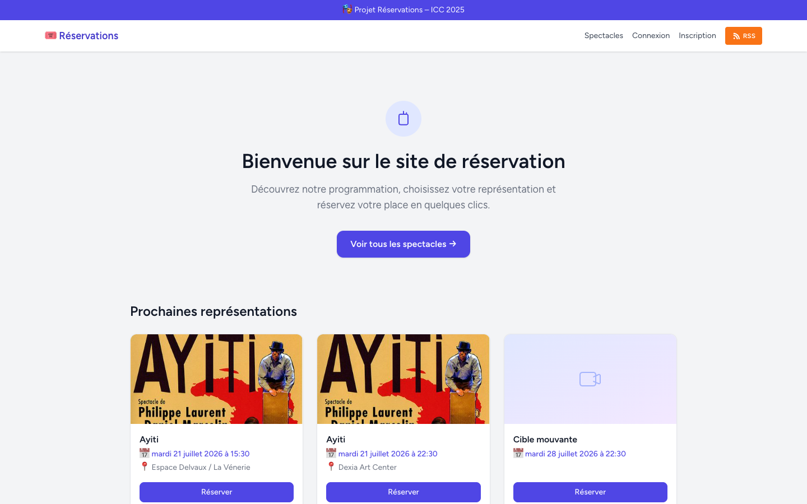
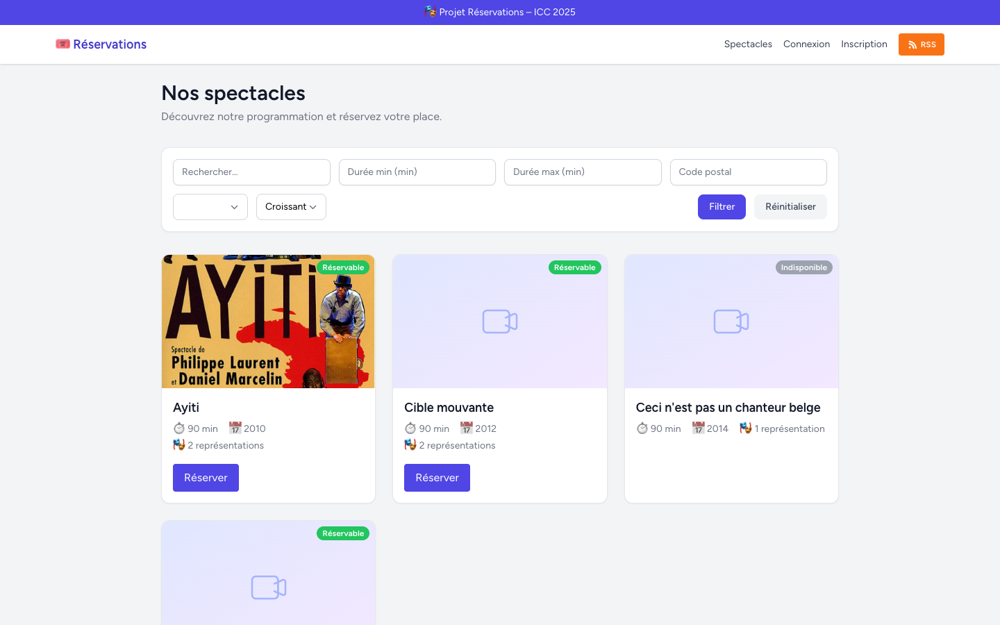
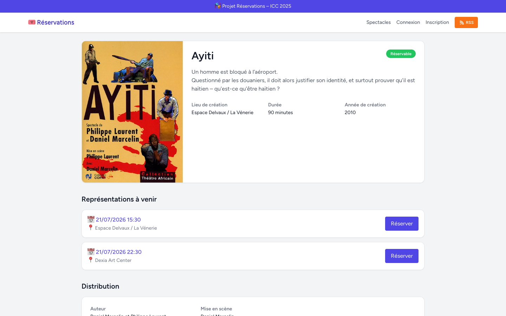
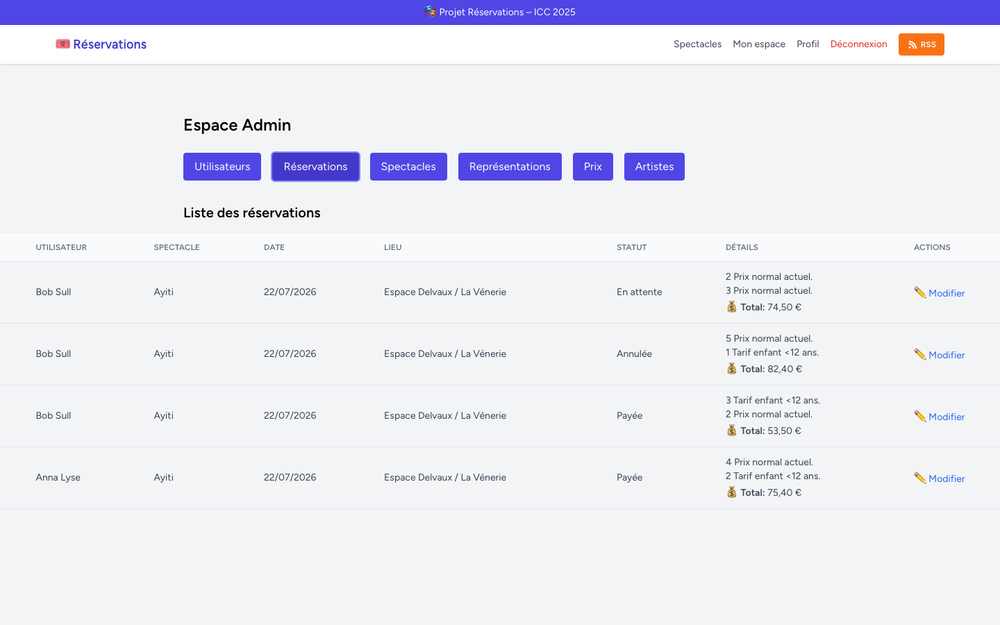

# Reservations 🎭

> A full-stack theatre ticketing web application built with **Laravel 11**, **Vue 3** and **Inertia.js**.

[](https://github.com/nasutance/Reservations/actions/workflows/ci.yml)


---

## Overview

**Reservations** is a full-stack application for managing theatre shows and their online ticketing. Users can browse available shows, view upcoming performances, and complete a booking through a guided multi-step flow. Administrators have a dedicated dashboard to manage all content and a RESTful API secured with Sanctum tokens.

## Screenshots

| Home | Show catalogue |
|------|----------------|
|  |  |

| Show detail | Admin dashboard |
|-------------|-----------------|
|  |  |

---

## Features

### Public
- Show catalogue with search and filters (keyword, artist, venue, duration, postal code)
- Show detail page: poster, description, cast, upcoming performances
- RSS feed of upcoming performances (Spatie Laravel Feed)

### Authenticated users
- Registration, login, email verification (Laravel Breeze)
- Multi-step reservation flow:
  1. Choose a performance
  2. Select pricing tiers and number of seats
  3. Choose delivery method
  4. Payment (PayPal sandbox integration)
  5. Confirmation
- Personalised dashboard: booking history, reservation status
- Reservation management: add pricing lines, cancel a booking
- Profile management: update email, password, delete account (soft delete)

### Administration
- Full CRUD for shows, performances, artists and prices from a single dashboard
- User management and role assignment (admin, affiliate, member)
- CSV import / export for shows
- RESTful API secured with Laravel Sanctum

---

## Tech stack

| Layer       | Technologies                                                      |
|-------------|-------------------------------------------------------------------|
| Backend     | PHP 8.2+, Laravel 11, Laravel Sanctum, Laravel Breeze            |
| Frontend    | Vue 3, Inertia.js, Tailwind CSS 3, Vite                          |
| Database    | SQLite (dev) / MySQL–MariaDB (prod), Eloquent ORM, Soft Deletes  |
| Auth & ACL  | Laravel Breeze, resource Policies, role-based access             |
| Extras      | Spatie Laravel Feed (RSS), Ziggy (client-side named routes)      |
| Testing     | Pest 3, PHPUnit, DatabaseTransactions                             |
| Tooling     | Docker Compose, GitHub Actions CI, Laravel Pint                   |

---

## Architecture

The app follows a **full-stack MVC** pattern with hybrid rendering via Inertia.js — no separate API calls for page navigation, no page reloads.

```
app/
├── Http/
│   ├── Controllers/        # Web controllers (Inertia::render)
│   │   └── API/            # API controllers (Form Requests + API Resources)
│   ├── Requests/           # Validation extracted into Form Request classes
│   └── Resources/          # JSON transformation layer for the API
├── Models/                 # Eloquent models with relationships, soft deletes, casts
├── Policies/               # Per-resource authorisation (Show, Reservation, Price, User, …)
└── Providers/

resources/js/
├── Components/             # Reusable Vue 3 components (DataTable, Modal, Pagination, …)
├── Layouts/                # AppLayout, AuthenticatedLayout, GuestLayout
└── Pages/
    ├── Dashboard/          # Admin & member dashboards
    ├── Reservation/        # 5-step booking wizard
    └── Show/               # Show catalogue & detail

database/
├── factories/              # Model factories for all entities
├── migrations/
└── seeders/                # Full demo dataset (portable: SQLite & MySQL)
```

Key patterns used:
- **Inertia.js** — seamless SPA feel without a separate frontend codebase
- **Laravel Policies** — every write endpoint (web & API) goes through a policy; roles alone are never trusted
- **Form Requests & API Resources** — validation and JSON shaping extracted out of the API controllers
- **Eloquent relationships** — BelongsToMany with pivot data (price, quantity), HasMany, SoftDeletes, eager loading
- **Sanctum** — token authentication for the `/api` endpoints
- **Ziggy** — named Laravel routes available in Vue components (`route('show.index')`)

---

## Getting started

### Option 1 — Docker (recommended)

```bash
git clone https://github.com/nasutance/Reservations.git
cd Reservations
cp .env.example .env

docker compose up -d
```

The stack (PHP app + MySQL) starts, installs dependencies, migrates and seeds the database automatically. The app is available at `http://localhost:8000`.

### Option 2 — Local PHP

Requirements: PHP 8.2+, Composer 2, Node.js 18+, npm.

```bash
git clone https://github.com/nasutance/Reservations.git
cd Reservations

# PHP dependencies
composer install

# Environment
cp .env.example .env
php artisan key:generate

# Database (SQLite by default)
touch database/database.sqlite
php artisan migrate --seed

# Frontend
npm install
npm run build     # or `npm run dev` for hot reload

php artisan serve
```

The app will be available at `http://localhost:8000`.

### Demo accounts

After seeding, two demo accounts are available:

| Login | Email                  | Password   | Roles         |
|-------|------------------------|------------|---------------|
| bob   | `bob@sull.com`         | `12345678` | admin, member |
| anna  | `anna.lyse@sull.com`   | `12345678` | member        |

20 additional accounts are generated via factories with random roles.

---

## API

A RESTful API is available under `/api` and secured with Laravel Sanctum.

```bash
# Get a token
curl -X POST http://localhost:8000/api/login \
  -H "Content-Type: application/json" \
  -d '{"email": "bob@sull.com", "password": "12345678"}'
```

| Method | Endpoint                  | Description                     |
|--------|---------------------------|---------------------------------|
| POST   | `/api/login`              | Get a Sanctum token             |
| GET    | `/api/shows`              | Paginated show list with filters|
| POST   | `/api/shows`              | Create a show (admin)           |
| GET    | `/api/shows/{id}`         | Show detail (with `?include=`)  |
| PUT    | `/api/shows/{id}`         | Update a show (admin)           |
| DELETE | `/api/shows/{id}`         | Delete a show (admin)           |
| GET    | `/api/representations`    | List performances               |
| GET    | `/api/reservations`       | List reservations (own / all)   |
| POST   | `/api/reservations`       | Book a performance              |

Authenticate by passing the token in the `Authorization: Bearer <token>` header.

---

## Testing

65 feature tests cover authentication, profile management, authorisation policies (shows, reservations, prices, users), the reservation flow and the REST API.

```bash
php artisan test
# or
./vendor/bin/pest
```

Tests run on every push via [GitHub Actions](.github/workflows/ci.yml) against PHP 8.2 and 8.3 with MySQL.

---

## License

Released under the [MIT License](LICENSE).
